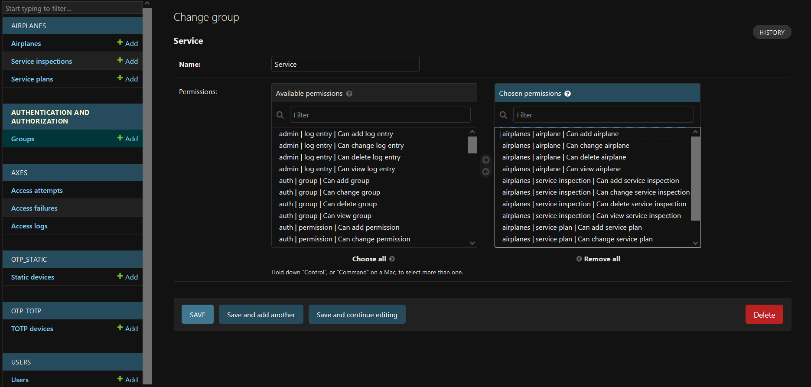

# Install guide

1. **Clone a repo**
2. **Create a virtual env** (https://docs.python.org/3/library/venv.html)  
`python3 -m venv /path/to/new/virtual/environment`
3. **Activate the virtual env:**  
Once a virtual environment has been created, it can be “activated” using a script in the virtual environment’s binary directory. 
The invocation of the script is platform-specific (\<venv> must be replaced by the path of the directory containing the virtual environment):

   |Platform|Shell|Command to activate virtual environment|
   |--------|-----|---------------------------------------| 
   |POSIX|bash/zsh|$ source \<venv>/bin/activate|
   |-|fish|$ source \<venv>/bin/activate.fish|
   |-|csh/tcsh|$ source \<venv>/bin/activate.csh|
   |-|PowerShell Core|$ \<venv>/bin/Activate.ps1|
   |Windows|cmd.exe|C:\> \<venv>\Scripts\activate.bat|
   |-|PowerShell|PS C:\> \<venv>\Scripts\Activate.ps1|
   
4. **Install requirements:**  
`pip install -r requirements.txt`
5. **Always run manage.py commands from the project root**
6. **Apply changes to the database models:**  
`python manage.py migrate`

# Migration guide
1. **[Activate the virtual env](#install-guide)**  
2. **Always run manage.py commands from the project root**
3. **Always run this command to apply changes to the database models:**  
`python manage.py migrate`
4. **Migrate data:**  
`python manage.py migrate_data`

# Run guide
1. **[Activate the virtual env](#install-guide)** 
2. **Always run manage.py commands from the project root**
3. **Always run this command to apply changes to the database models:**  
`python manage.py migrate`
4. **Run server:**  
`python manage.py runserver`

# Internationalization (i18n)
This project is configured for Czech (default) and English. Admin is forced to English.

- Add or update translations:
  - Extract messages: `python manage.py makemessages -l cs -l en`
  - Edit: `locale/cs/LC_MESSAGES/django.po` (and `locale/en/...` if needed)
  - Compile: `python manage.py compilemessages`
- In templates, add `` and wrap texts with `` or ``.
- In Python, wrap user-facing strings with: `from django.utils.translation import gettext as _` and use `_("Your text")`.
- To test English UI (except admin): set `LANGUAGE_CODE = "en"` temporarily or use Django’s language switching (session/cookie) if you add a language selector view.

# How to set permissions
1. **Log in to the Admin Panel**
2. **Create the user intended for service permissions** 
3. **Add a permission Group named "Service"**
4. **Choose all permissions related to "airplanes" for this Group**  
    
5. **Click 'Save'**

# How to fix possible 2FA database error
1. **If "phonedevice" missing table error is encountered**
2. **Add "two_factor.plugins.phonenumber" app to settings.py temporarily** 
3. **Run this command:**  
    `python manage.py migrate`
4. **Remove "two_factor.plugins.phonenumber" app from settings.py**
5. **Run this command again:**  
    `python manage.py migrate`

# Backfill monthly meter readings
1. Activate the virtual environment (see Install guide).
2. From the project root, run:

   Windows/PowerShell:
   - python manage.py create_past_readings --months 20

   Optional arguments:
   - --meter-name "Electricity Main"  (choose a specific meter by name)
   - --value-start 100.00              (starting decimal value for first month)
   - --increment 1.00                  (value increment per subsequent month)
   - --include-current                 (include current month as well)

Notes:
- Ensures at most one reading per calendar month for the selected meter.
- By default, the current month is skipped; use --include-current to include it.
- If no meter exists, a demo meter is created automatically.
- Reading.timestamp uses auto_now_add, so the command creates then updates the timestamp to the target past month.

# For downloading PDFs with czech alphabet:
    - Download 'DejaVuSans.ttf' from 'https://github.com/dejavu-fonts/dejavu-fonts/releases' and save it under static/assets/fonts